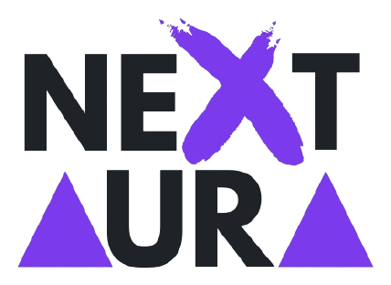

  <picture>
    <source media="(prefers-color-scheme: dark)" srcset="logo-dark.png">
    <source media="(prefers-color-scheme: light)" srcset="logo-light.png">
    
  </picture>

<h1 align="center">NextAura</h1>

  Software a medida, productos propios y soporte IT 
  <a href="https://nextaura.es">nextaura.es</a> · España

---

**NextAura** desarrolla y comercializa productos de software propios y presta servicios de desarrollo a
medida, automatización, consultoría IT, correo y soporte. Aquí vive su plataforma interna y los
productos que vende.

### Plataforma de NextAura

| Repositorio | Qué es | Tecnología |
| --- | --- | --- |
| [`nextaura`](https://github.com/NextAura-ES/nextaura) | Documentación común: arquitectura, entorno local, auditorías y guía de PRs | Markdown |
| [`nextaura-api`](https://github.com/NextAura-ES/nextaura-api) | API: clientes, proyectos, tickets, correo NextMails, facturación, contabilidad y tesorería | NestJS · PostgreSQL · Socket.IO |
| [`nextaura-intranet`](https://github.com/NextAura-ES/nextaura-intranet) | Intranet del equipo: proyectos, soporte, ventas, facturación y administración | Next.js · React |
| [`nextaura-web`](https://github.com/NextAura-ES/nextaura-web) | Web comercial, blog y área privada de clientes | Next.js · React |
| [`nextaura-ui`](https://github.com/NextAura-ES/nextaura-ui) | Sistema de diseño compartido con Storybook, publicado como `@nextaura-es/ui` | React · Storybook |
| [`nextaura-roundcube`](https://github.com/NextAura-ES/nextaura-roundcube) | Tema de Roundcube para el webmail de NextMails | Less · Roundcube |

### Productos

| Repositorio | Qué es | Tecnología |
| --- | --- | --- |
| [`nextanalyzer`](https://github.com/NextAura-ES/nextanalyzer) | **NextAnalyzer**: monitorización y protección de equipos con agente de escritorio, panel de clientes y backoffice ([nextanalyzer.com](https://nextanalyzer.com)) | Electron · Wazuh · NestJS · Next.js |
| [`nextremote`](https://github.com/NextAura-ES/nextremote) | **NextRemote**: escritorio remoto gratuito, financiado con aportaciones voluntarias | Electron · Rust · WebRTC · NestJS · Next.js |

### Otras organizaciones

Cada gran proyecto tiene su propia organización:

- [**Imora**](https://github.com/Imora-ES): ERP, web y apps para servicios a comunidades de propietarios.
- [**Salud en Ruta**](https://github.com/SaludEnRuta): avisos médicos a domicilio, historia clínica y facturación.
- [**Vértice Gestión Empresarial**](https://github.com/Vertice-ES): web de la gestoría digital.
- [**RLST**](https://github.com/RLST-ES): inversión y gestión de inmuebles de lujo.
